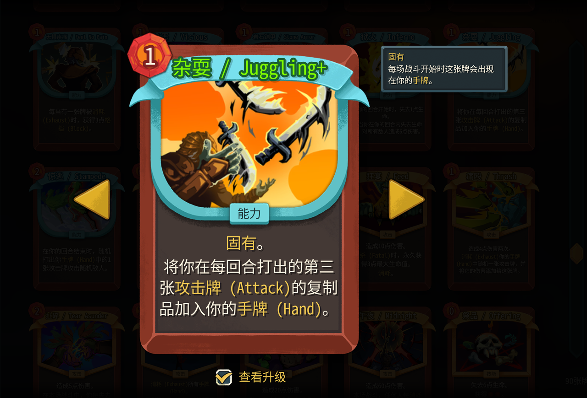

# SpireTerms — 杀戮尖塔 2 卡牌术语中英对照

打牌的时候顺手记几个英文单词。

中文一点没少，只是卡名和描述里的关键词后面多跟一个英文：`杂耍 / Juggling`、`攻击牌 (Attack)`、`手牌 (Hand)`。玩着玩着就认得了，不用专门坐下来背。



## 效果

| 位置 | 形式 |
|---|---|
| 卡名 | `磨蚀 / Abrasive` |
| 描述里的关键词 | `获得 1 点[gold]敏捷 (Dexterity)[/gold]。` |
| 描述正文 | 不变 |
| 数值、升级高亮、条件分支 | 不变（`{Damage:diff()}`、`{IfUpgraded:…}` 一个字节不动） |

只标关键词，判断依据是游戏自带的词表：`powers`、`card_keywords`、`orbs`、`static_hover_tips` 里的名字，加上卡名反查。不做分词，所以「力量」这种既是指关键词又是普通用词的地方也不会标错。

## 安装

安装包在 [Releases](https://github.com/alder862/SpireTerms/releases) 里，下 `SpireTerms.zip` 解压。

1. 把整个 `SpireTerms` 文件夹放进游戏根目录的 `mods/`：
   ```
   Slay the Spire 2/mods/SpireTerms/SpireTerms.json
   Slay the Spire 2/mods/SpireTerms/SpireTerms.pck
   ```
   注意不是 `data_sts2_windows_x86_64/mods/`。
2. 启动游戏，进 `加载 Mods`，列表里能看到 `SpireTerms` 就对了。
3. 语言得是简体中文。英文客户端下这个 mod 不起作用。

卸载就是删掉 `mods/SpireTerms/`，不碰存档，也不改设置。

## 兼容版本

适配游戏 **v0.111.0**（EA 期）。文本是按这个版本烘焙的，游戏更新后可能出现新卡没英文、或者旧卡文案停在旧版。

卡面数值走 `{Damage}` 这类动态变量，不会过期；会过期的是措辞和机制说明——这个 mod 是整串覆盖，所以旧文案会把中文一起盖住。

版本对不上不会报错也不会崩，只是慢慢变旧。看到明显过时的描述，卸了就行。

## 已知限制

- 只做卡牌（卡名 + 描述关键词）。遗物、药水、事件、对话还没做。
- 只做简体中文（`zhs`）。
- 没有游戏内开关，装上即生效，卸掉即还原。
- 19 个只有英文的 key（诅咒、状态卡，比如 `DAZED`、`GREED`），中文客户端本来就没中文，跳过。
- 升级卡的加号由游戏追加在末尾，所以是 `杂耍 / Juggling+`，不是 `杂耍+ / Juggling`。数据层改不了。
- 长描述不会被截断，也不会缩字号，所以没做例外规则。

## 构建

```bash
python tools/build.py --out dist
```

产物：

```
dist/SpireTerms/SpireTerms.json     # mod 清单（has_pck=true）
dist/SpireTerms/SpireTerms.pck      # 本地化覆盖
dist/cards.zhs.json                 # 打包源文件，方便 review，不进 mod 目录
```

默认读 `D:\Steam\steamapps\common\Slay the Spire 2\SlayTheSpire2.pck`，也可以用环境变量 `STS2_PCK` 或 `--pck` 指定。

### 为什么是 PCK

v0.111.0 实测：扁平放在 `mods/<Mod>/localization/` 不会被合并，loader 只挂 PCK 和 DLL；而 mod 的 PCK 里路径必须以 mod id 作前缀（`SpireTerms/localization/zhs/cards.json`），否则报 `Failed to parse language file`。PCK 由 [tools/pck_write.py](tools/pck_write.py) 按 Godot pack v3 生成。

另一条能用的路是覆盖目录：把 `localization/zhs/cards.json` 拷到 `%APPDATA%\SlayTheSpire2\localization_override\zhs\`，游戏也会合并，日志里能看到 `Localization overrides are active`。这条路不能上创意工坊。

## 词表怎么来的

没做翻译，全部取自游戏自带的官方中英文本，一共 1208 条：

1. **官方表反查**（1166 条）：46 张本地化表的 `.title` 做 zh→en 映射，其中卡名 615 条，其余是能力、关键词、充能球、悬浮提示、遗物、药水。实测没有重名冲突。
2. **平行文本学习**（25 条）：同一张卡的中英描述里，`[gold]` 片段按位置对齐，多数票（至少 2 次、占比 80% 以上）才采纳。用来抓「手牌 → Hand」「弃牌堆 → Discard Pile」这种表里没有的词。
3. **人工修正**（17 条）：区域词和上下文有歧义的地方，比如 `升级` 要翻成 Upgraded 而不是 Upgrade。

## 校验

`build.py` 有三条不变式，任何一条不满足就非零退出：

- 可逆：删掉插入的英文后，必须和官方中文逐字相等；
- 不碰表达式：`{}` 内部零改动，花括号配平；
- key 合法：只输出当前游戏表里存在的 key。

`tools/drift.py` 用来对比产物和当前游戏版本，报告新增 key、消失 key、格式串异常，判断这版还能不能发。

## 许可

MIT。文本版权归 Mega Crit Games，本仓库只做索引和拼接。
